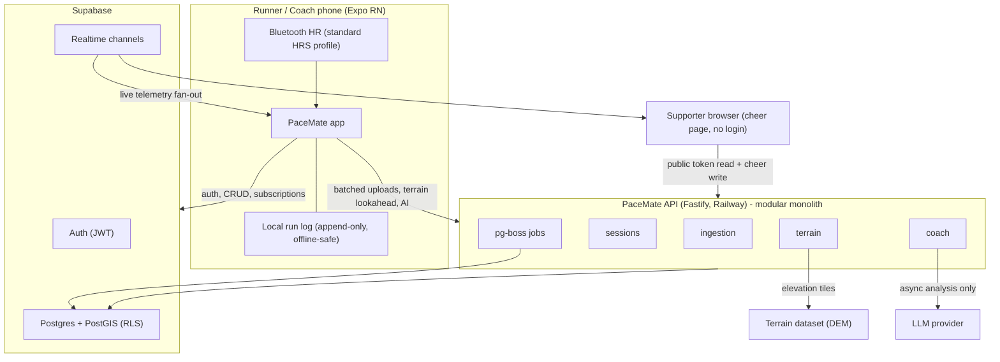

# PaceMate v2 Architecture

Status: living document. Decisions behind this shape are in `docs/adr/`.

## 1. System context

## 2. Module map (backend)

Each module exposes `public.ts` and owns its tables. Cross-module access goes
through the public interface only (lint-enforced).

| Module      | Owns tables                          | Responsibility |
|-------------|--------------------------------------|----------------|
| `ingestion` | `gps_points`, `hr_samples`           | Accept batched, idempotent telemetry uploads; validate; dedupe |
| `sessions`  | `sessions`, `cues`                   | Session lifecycle, summary stats, cue dispatch |
| `terrain`   | `routes`, `route_segments`           | Elevation lookup, smoothing, grade, climb segmentation, lookahead ("6% climb in 400 m"), grade-adjusted pace |
| `coach`     | `coach_rules`, `analyses`, `plans`   | Deterministic live rules engine; LLM post-run analysis and plan generation as jobs |

Cheer lives inside `sessions` for now (a token and a message are not a module).
Extract only if it grows real behaviour.

## 3. Live session data flow

1. Runner starts a session. Row created in `sessions`, status `active`.
2. Phone records GPS (and HR if paired) to the local append-only log every
   tick, regardless of network.
3. Every ~5 s the phone uploads the unsent tail as a batch to
   `POST /ingest/:sessionId`. Keys are `(session_id, seq)`; replays are no-ops.
4. Ingestion validates, inserts, then broadcasts the latest point + computed
   stats on the session's Supabase Realtime channel.
5. Coach app and cheer page subscribe to that channel. No polling.
6. `coach` rules engine evaluates each update (pace vs target, HR zone,
   terrain lookahead from `terrain`) and emits cue events on the same channel.
   The runner's phone speaks them (TTS).
7. On stop, `sessions` finalises stats and enqueues a post-run analysis job.

## 4. Terrain pipeline

1. Route (planned, or map-matched from a free run) resampled every 10-20 m.
2. Elevation per point from a DEM source (see ADR 0005), cached in
   `route_segments`.
3. Smoothing, grade per segment, climb segmentation (start, length, avg %).
4. Lookahead query: given current position + direction, next N segments.
5. Grade-adjusted pace computed per split so effort is judged fairly.
6. Pre-computed profiles shipped for marquee SA routes (Comrades, Two Oceans).

## 5. Scaling path (when, not if, it is earned)

| Trigger | Action |
|---------|--------|
| Realtime fan-out limits | Extract a realtime service behind the existing channel seam |
| Terrain CPU load | Move `terrain` workers to their own process (same code, new deploy) |
| LLM volume | Dedicated job workers; queue already isolates this |

Nothing else splits until a measured trigger fires. The module boundaries are
the future service boundaries; that is the whole point of keeping them strict.

## 6. Security and POPIA baseline

- RLS on every table, default deny. Policies live with migrations.
- Run and HR data is health-adjacent personal information: explicit consent
  at signup, documented cross-border justification before any LLM provider
  sees runner data, in-app export and delete flows from the first release.
- Cheer tokens are unguessable, expiring, and read-scoped: a supporter sees
  position and stats, never identity or history.
- API secrets never ship in the app bundle. The app holds only the Supabase
  anon key; everything privileged runs server-side.
